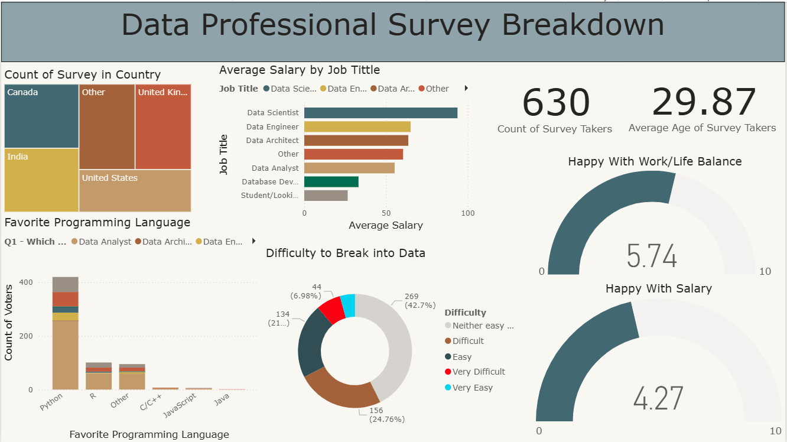

# Data Professional Survey Analysis (Power BI)

An interactive Power BI report analyzing a survey of **630 data professionals**.

## Demo

[Watch the dashboard demo video](PASTE-YOUR-VIDEO-LINK-HERE)

## What the report shows
- Respondents by country (treemap)
- Average salary by job title (bar chart)
- Favorite programming language by job title (stacked column chart)
- Difficulty of breaking into data (donut chart)
- KPI cards: number of survey takers (630) and average age (29.87)
- Gauges: happiness with work/life balance (5.74 / 10) and with salary (4.27 / 10)

## Findings
- Python is the most preferred programming language by a large margin.
- Data Scientists report the highest average salary among the job titles shown.
- Respondents are happier with work/life balance (5.74/10) than with salary (4.27/10).
- The most common answer on difficulty of entering the field was neither easy nor difficult (about 43%).

## Tools
Power BI Desktop

## Files
- `Data_Professional_Survey.pbix` - Power BI report
- `screenshots/` - dashboard images

## Data
The dataset was provided as part of my coursework.
