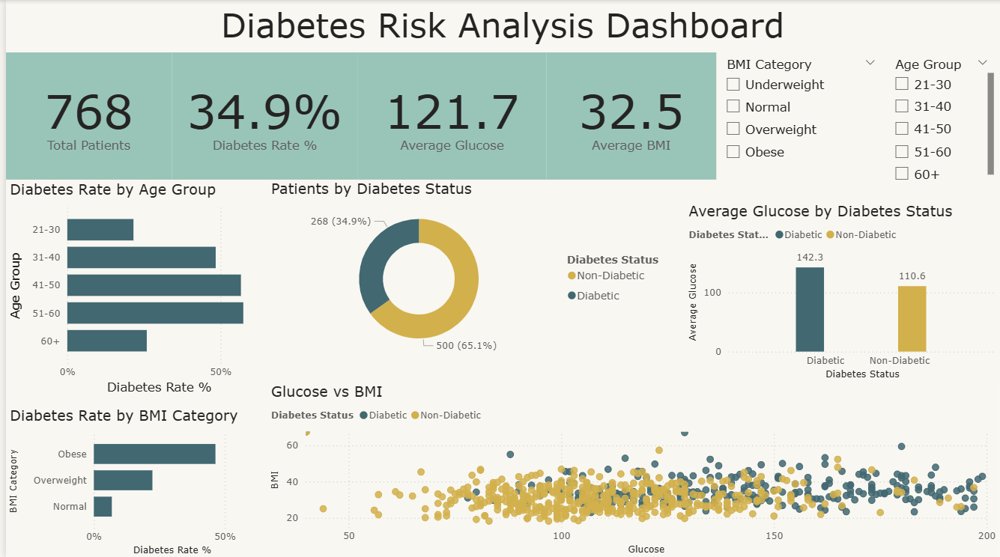

# Diabetes Risk Analysis Dashboard and Prediction Model

A Power BI dashboard and a machine-learning model built on the **Pima Indians Diabetes dataset** (768 records).

## Demo

[Watch the dashboard demo video](https://youtu.be/U1aTj0C90Y0)

## Data preparation
- Added column names (the raw file has no header row).
- In this dataset, missing values in Glucose, BloodPressure, SkinThickness, Insulin and BMI are stored as 0. I converted them to blanks so averages are correct (done in Python, see `retrain.py`).
- In Power Query I added: **Diabetes Status**, **Age Group**, **BMI Category** and **BMI Sort** columns.

## DAX measures
Total Patients, Diabetic Patients, Diabetes Rate %, Average Glucose, Average BMI, Average Age.

## Dashboard
- KPI cards: 768 patients, 34.9% diabetes rate, average glucose 121.7, average BMI 32.5
- Diabetes rate by age group and by BMI category
- Patients by diabetes status (donut chart)
- Average glucose by diabetes status
- Glucose vs BMI (scatter chart)
- Slicers: BMI Category and Age Group

## Findings
- About 35% of patients in the dataset are diabetic.
- Diabetic patients have a higher average glucose (about 142) than non-diabetic patients (about 111).
- Diabetes rate rises with BMI: about 7% for Normal, 22% for Overweight and 46% for Obese.
- The rate is highest in the 41-50 and 51-60 age groups (about 57%) and lowest in the 21-30 group (about 22%).

## Prediction model
Random Forest classifier trained on 80% of the data and tested on 20% (median imputation for missing values):
- Accuracy: **77%**
- Diabetic class: precision **0.70**, recall **0.59**

## Files
- `Diabetes_Dashboard.pbix` - Power BI report
- `retrain.py` - model training and evaluation
- `pima_diabetes_clean.csv` - cleaned dataset
- `screenshots/` - dashboard images
