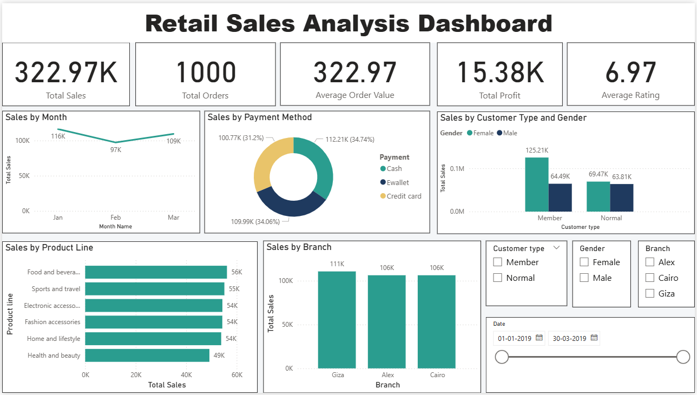

# Retail Sales Analysis Dashboard (Power BI)

A Power BI dashboard built on a public supermarket sales dataset (**1,000 invoices, 17 columns**).

## Demo

[Watch the dashboard demo video](PASTE-YOUR-VIDEO-LINK-HERE)

## Data preparation (Power Query)
- Set data types and converted the Date column using the English (United States) locale, because the dates are in month/day/year format.
- Renamed columns (Tax 5% to Tax, gross income to Gross Income, cogs to COGS).
- Removed the gross margin percentage column, which had the same value in every row.
- Checked for blanks, errors and duplicate invoices (none found).

## Data model
A separate **Date table** (CALENDAR) with Year, Month Name and Month Number columns, linked to the sales table with a one-to-many relationship and marked as the date table.

## DAX measures
Total Sales, Total Orders, Average Order Value, Total Profit, Average Rating.

## Dashboard
- KPI cards: 322.97K total sales, 1,000 orders, 322.97 average order value, 15.38K profit, 6.97 average rating
- Sales by month, payment method, product line, branch, and customer type and gender
- Slicers: Branch, Customer type, Gender and Date range

## Findings
- January had the highest sales (116K) and February the lowest (97K).
- Food and beverages was the top product line (56K), followed closely by Sports and travel (55K).
- Cash was the most used payment method (about 35% of sales).
- Giza was the top branch (111K), and female Member customers were the largest segment (about 39% of sales).
- This is a practice dataset, so differences between groups are small.

## Files
- `Retail_Sales_Dashboard.pbix` - Power BI report
- `SuperMarket_Analysis.csv` - dataset
- `screenshots/` - dashboard images
